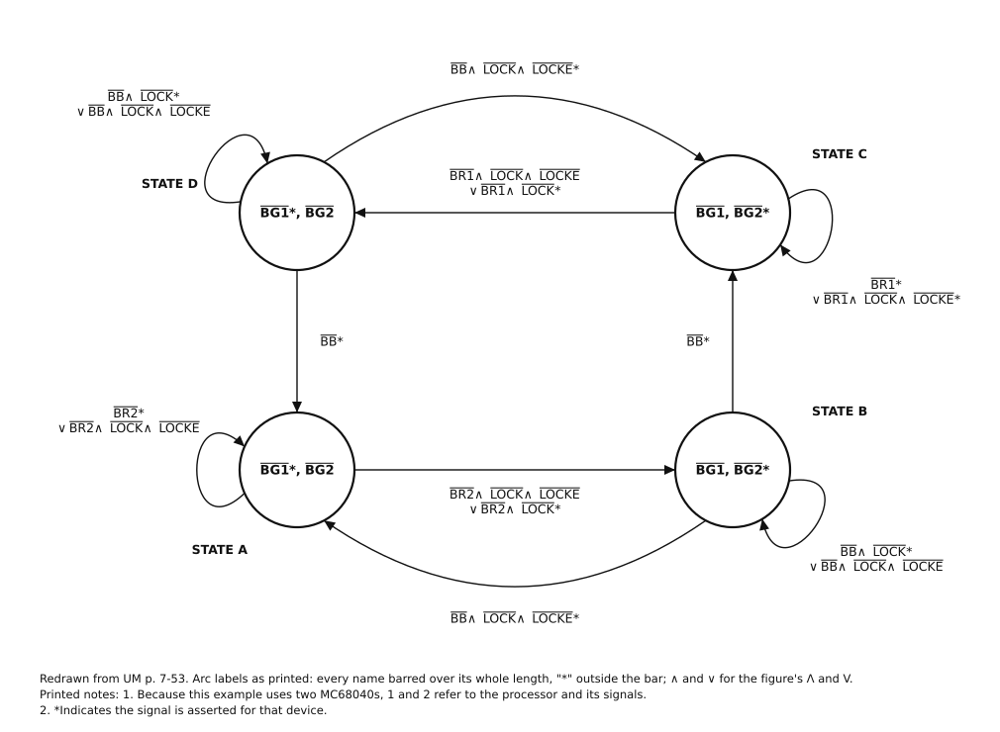
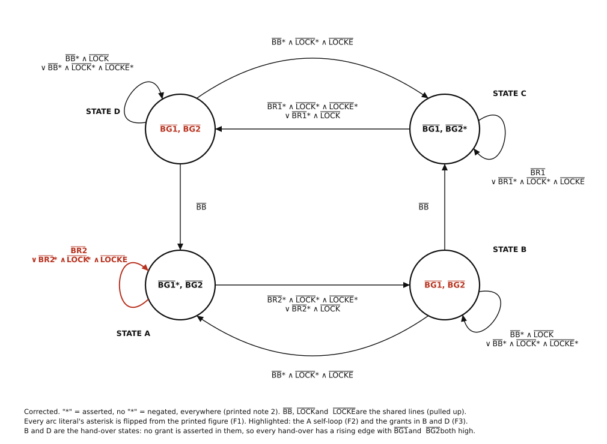
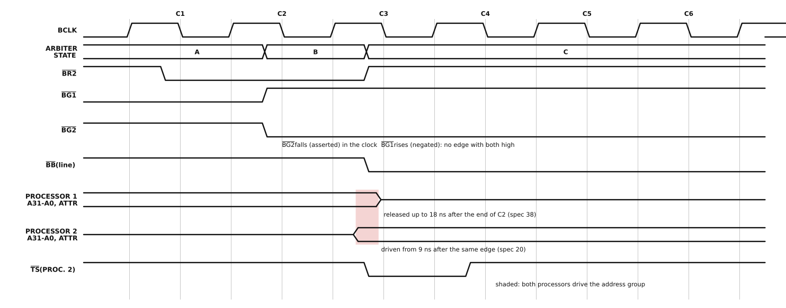
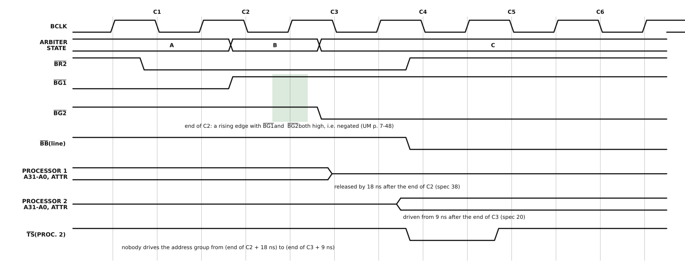
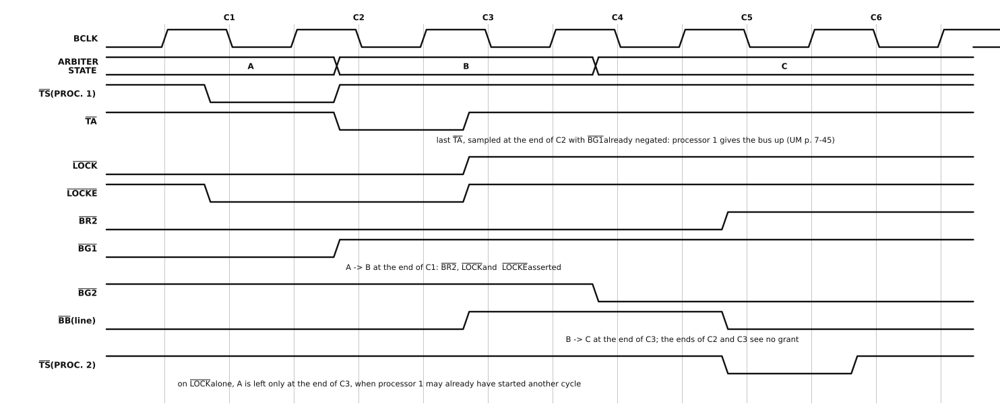

# UM 7.8.2.1, Dual M68040 Fairness Arbitration: checked and corrected

Motorola's addendum to the user's manual (MC68040UMAD/AD) says of the bus arbitration
examples: "Page 7-52 to 7-58: Section 8.2 Bus Arbitration Examples section contains many
errors in various figures. Please ignore this section if it confuses the reader." It means
UM §7.8.2 (`Inputs/doc/MC68030_Doc_More_Readable/MC68040UM_split/README.md`, which also
notes the wrong section number). This file takes the first of those examples, §7.8.2.1,
transcribes it, checks every claim and every arc against the rest of the manual, and
proposes a corrected text and figure.

The corrected arbiter runs two RD68041s in `core_smp_tb` (`doc/smp.md`), where the
printed figure's handover (F3) is shown on the bus.

The short version: the text is mostly right, and the figure is wrong in three ways.

- Figure 7-35 gives its asterisk two meanings. The state outputs follow note 2, where
  "\*" means asserted. The arc conditions only make sense if "\*" means *negated*.
- The state A self-loop is missing one asterisk.
- The arbiter hands the bus over with no clock edge where both grants are negated, which
  UM p. 7-48 and the addendum require.

The text has two sentences that name processor 1 where they mean processor 2.

**Notation.** The manual draws a bar over the name of every active-low signal. Where a bar
cannot be drawn, this file writes it as a leading slash (the RTL uses an `_n` suffix
instead, `doc/pinout.md`): /BR2 is the pin printed as BR2 with a bar over it, at logic low
(0) when asserted. Every signal in this subsection is active low, so every signal name
below carries the slash: /BR1, /BR2, /BG1, /BG2, /BB, /LOCK, /LOCKE, /TS, /TA. In the SVGs
the bar is drawn over the name. "Asserted" and "negated" are used as the manual uses them:
/BG1 asserted means the /BG1 pin is low.

**Revision.** The first version of this file dropped the overbars, on the grounds that
every name carried one. A review asked whether the analysis depended on them. Section 2.3
now records every bar in Figure 7-35, literal by literal, measured from the PDF's vector
strokes rather than read off an image. Every name is barred over its whole length, and no
asterisk is under a bar. Section 3.1 now evaluates the figure under four readings of bar
and asterisk instead of two. The conclusions did not change. No placement of bars,
present or missing, makes the printed figure agree with the text, because the bars do not
vary. F1 is restated as a conflict between two meanings of the asterisk, and the arcs are
no longer said to be "inverted" outright. Its alternative correction, rewording note 2,
is now given too. F2, F3, T1, T2 and the ambiguities stand as they were, with F3 now
argued in pin levels as well (section 4.3). The figures and the checker were redrawn with
the bars, and the text uses the /NAME notation.

---

## 1. Source and scope

| | |
|---|---|
| Section | UM §7.8.2.1, "Dual M68040 Fairness Arbitration" |
| Pages | UM p. 7-52 (last paragraph) to p. 7-54 (first three paragraphs); PDF pages 52-54 of `10-section-07-bus-operation.pdf` |
| Figure | Figure 7-35, "Dual M68040 Fairness Arbitration State Diagram", UM p. 7-53 |
| Tables | none; the subsection uses no table and no timing diagram |
| Checked against | UM §7.8 and §7.8.1 (pp. 7-44 to 7-52, Figures 7-30 to 7-34, Table 7-6); §5.3.7, §5.3.8, §5.6 (pp. 5-7 to 5-9); §7.4.5 (pp. 7-26 to 7-29); §7.7 retry (p. 7-41); Table 7-2 (p. 7-6); Figure 11-4 and `ac-electrical-specifications.csv`; Appendices A, B and C; the addendum and clarification items in `MC68040UM_split/README.md`; `doc/manual-contradictions.md` |
| Secondary evidence | Figure 7-36 (§7.8.2.2, the same arbiter with fixed priority); `rtl/rd68041_biu.sv` and `sim/tb/bus_arb_tb.sv`; `Inputs/QuadraFPGA/` |
| Not in scope | §7.8.2.2 to §7.8.2.4, except where Figure 7-36 helps read Figure 7-35 |

Appendices A (MC68LC040), B (MC68EC040) and C (MC68040V) do not repeat §7.8.2; they repeat
only Figure 11-4, as Figures A-6, B-9 and C-14. The index lists "Bus Arbitration,
7-44-7-58" and nothing else for this material.

Figures:

| File | What |
|---|---|
| [`um-7-8-2-1-fig-7-35-printed.svg`](um-7-8-2-1-fig-7-35-printed.svg) | Figure 7-35 redrawn as printed |
| [`um-7-8-2-1-fig-7-35-corrected.svg`](um-7-8-2-1-fig-7-35-corrected.svg) | Figure 7-35 corrected |
| [`um-7-8-2-1-handover-printed.svg`](um-7-8-2-1-handover-printed.svg) | not in the manual: a handover through the printed arbiter (error F3) |
| [`um-7-8-2-1-handover-corrected.svg`](um-7-8-2-1-handover-corrected.svg) | not in the manual: the same handover through the corrected arbiter |
| [`um-7-8-2-1-locke-corrected.svg`](um-7-8-2-1-locke-corrected.svg) | not in the manual: a locked sequence ended with /LOCKE, corrected arbiter |

All five are generated by `tools/um_figures/um_7_8_2_1.py`. It also checks every arc of
both versions of the figure (section 3.1). The timing diagrams use the engine of the
redrawn section 11 figures (`MC68040UM_split/timingsvg.py`, imported read-only) and its
conventions: the vertical lines are BCLK half periods, and BCLK rises at the start of each
numbered clock. As in Figure 11-4, placement is schematic. Where a time matters, the
specification number is given and the value is the MC68040's at 25 MHz.

---

## 2. The original, transcribed

### 2.1 Text

Transcribed from UM pp. 7-52 to 7-54, with the line breaks taken out. Every signal name in
the printed text carries an overbar over the whole name, digit included (section 2.3).
Here each one is written /NAME.

> **7.8.2 Bus Arbitration Examples**
>
> The following paragraphs illustrate the behavior of the M68040 bus arbitration scheme
> and provide examples of how an external bus arbiter can be designed to keep the
> integrity of locked bus operations. The examples include the previously mentioned
> indeterminate and disregard request conditions.
>
> **7.8.2.1 DUAL M68040 FAIRNESS ARBITRATION.** The following state diagram illustrates a
> fairness algorithm using two MC68040s and assigning the least priority to the processor
> that owns the bus. If both processors keep their respective /BR signals asserted, bus
> ownership alternates between the two processors so that each processor can run at least
> one bus cycle during its tenure. Each processor is allowed to own the bus without
> relinquishing it to maintain the integrity of locked transfers. This example also
> illustrates how the /LOCKE signal can be used to end a locked sequence and to yield the
> bus one bus cycle earlier than is normally possible. Figure 7-35 illustrates the state
> diagram of a hypothetical external arbiter design.
>
> *[Figure 7-35]*
>
> Assuming that processor 1 currently owns the bus, the external arbiter is in state A. If
> processor 2 asserts /BR2, then processor 1 behaves in one of three ways:
>
> 1. If processor 1 is currently in the middle of a nonlocked bus access, then the external
>    arbiter proceeds to state B, in which /BG1 is negated and /BG2 is asserted. The
>    external arbiter then proceeds to state C only when /BB is negated, signifying the end
>    of the bus cycle.
> 2. If processor 1 is currently in the middle of a locked bus access, then the external
>    arbiter stays in state A until /LOCKE is asserted. Once /LOCKE is asserted, the
>    external arbiter enters state B, in which /BG1 is negated and /BG2 is asserted. The
>    external arbiter proceeds to state C once /BB is negated, signifying the end of the
>    bus cycle.
> 3. If processor 1 is in one of the three boundary conditions, then the external arbiter
>    proceeds to state B. During state B, the external arbiter checks for the possibility
>    of a newly initiated locked bus access. If it detects a locked bus cycle, it returns
>    the bus to processor 1 by entering state A. Note that even though processor 1
>    recognizes /BG1 is asserted, it does not take the bus because processor 1 asserts /BB
>    whenever the boundary condition results in processor 1 performing another bus cycle.
>    The external arbiter stays in state A until /LOCKE is asserted, then proceeds to state
>    B to give the bus to processor 2. The arbiter remains in state B until /BB is negated,
>    signifying the end of the bus cycle.
>
> Once state C is reached, depending on whether or not processor 2 asserts /BR2 and then
> negates /BR2 because of a disregard request condition, processor 1 may or may not
> actively begin a bus cycle. If no other bus requests are pending by the time state C is
> reached, processor 2 is in the implicit ownership state. If processor 1 asserts /BR1,
> then it is possible for state C to persist for only one clock. In this case, processor 2
> does not have a chance to run any active bus cycles.
>
> A null bus cycle tenure is better than having the external bus arbiter wait for
> processor 2 to perform at least one bus cycle before returning bus ownership to
> processor 1, even though this appears to be a waste of bus arbitration overhead. Note
> that once processor 2 enters the disregard request condition, processor 2 reasserts /BR
> anywhere from one clock to an undetermined number of clocks before running another bus
> cycle. Waiting for processor 2 to run a bus cycle can result in a temporary bus
> arbitration lockup.
>
> This bus arbitration scheme is restricted if the system supports the relinquish and
> retry operation that can occur for the last write cycle of a locked transfer. In this
> case, /LOCKE cannot be used. Assuming that /LOCKE is always negated excludes the need for
> /LOCKE in an arbitration similar to this example. The reason for this restriction is that
> the external bus arbiter gives up the bus to the other processor once /LOCKE is asserted.
> If a relinquish and retry operation were to occur, then the next bus cycle would be from
> the other processor violating the integrity of the locked transfer.

### 2.2 Figure 7-35, as printed



Four states, drawn as circles at the corners of a square: D top left, C top right, A
bottom left, B bottom right. Each circle holds the arbiter's two outputs. Each arc carries
a condition built from signal names, "Λ" (and), "V" (or), and an asterisk after a name.
The figure's notes:

1. "Because this example uses two MC68040s, 1 and 2 refer to the processor and its
   signals."
2. "*Indicates the signal is asserted for that device."

Transcribed from the PDF's text layer and vector strokes (section 2.3), and checked
against the page rendered at 400 and 600 dpi. pdftotext's plain output loses some
asterisks and every bar. In the table, "/" is the printed bar, which covers the whole
name, and "\*" the printed asterisk, which always stands after the bar:

| From | To | Condition as printed | Drawn as |
|---|---|---|---|
| A | A | /BR2\* V /BR2 Λ /LOCK Λ /LOCKE | loop on the left of A |
| A | B | /BR2 Λ /LOCK Λ /LOCKE V /BR2 Λ /LOCK\* | straight, along the bottom |
| B | B | /BB Λ /LOCK\* V /BB Λ /LOCK Λ /LOCKE | loop below and right of B |
| B | C | /BB\* | straight, up the right side |
| B | A | /BB Λ /LOCK Λ /LOCKE\* | curve below the A-B line |
| C | C | /BR1\* V /BR1 Λ /LOCK Λ /LOCKE\* | loop below and right of C |
| C | D | /BR1 Λ /LOCK Λ /LOCKE V /BR1 Λ /LOCK\* | straight, along the top |
| D | D | /BB Λ /LOCK\* V /BB Λ /LOCK Λ /LOCKE | loop above and left of D |
| D | A | /BB\* | straight, down the left side |
| D | C | /BB Λ /LOCK Λ /LOCKE\* | curve above the D-C line |

| State | Outputs as printed | Read with note 2 (reading a) |
|---|---|---|
| A | /BG1\*, /BG2 | /BG1 asserted, /BG2 negated |
| B | /BG1, /BG2\* | /BG1 negated, /BG2 asserted |
| C | /BG1, /BG2\* | /BG1 negated, /BG2 asserted |
| D | /BG1\*, /BG2 | /BG1 asserted, /BG2 negated |

The drawing is symmetric. C and D do for processor 1 what A and B do for processor 2,
with /BR1 in place of /BR2. The one place the symmetry breaks is the A and C self-loops:
C's second term ends /LOCKE\*, and A's ends /LOCKE (error F2).

/BB, /LOCK and /LOCKE carry no 1 or 2. They are the shared bus lines, driven by whichever
processor owns the bus.

### 2.3 The overbars, measured

The figure's labels are set in Helvetica Narrow, and each bar is a separate stroked line,
so they can be measured instead of judged by eye. `python3 tools/um_figures/um_7_8_2_1.py
--bars <pdf> 53 115 380` matches every stroke against the word boxes of `pdftotext -bbox`.
For each word it reports the bar over it and the length of word, if any, left uncovered
at the right. The words are in PDF points from the top of the page.

Figure 7-35, every literal (44 names: 36 in the arcs and 8 in the states):

| Where | Literals, in order (/ = barred over the whole name) | Uncovered right end |
|---|---|---|
| A, outputs | /BG1\*, /BG2 | "\*," (5.0 pt) after /BG1; /BG2 none |
| A self-loop | /BR2\* V /BR2 Λ /LOCK Λ /LOCKE | "\*" (2.8 pt); the rest 0.2 to 0.8 pt |
| A to B | /BR2 Λ /LOCK Λ /LOCKE V /BR2 Λ /LOCK\* | "\*" (2.0 pt); the rest 0.0 to 0.5 pt |
| B, outputs | /BG1, /BG2\* | "," and "\*" (2.7 pt each) |
| B self-loop | /BB Λ /LOCK\* V /BB Λ /LOCK Λ /LOCKE | "\*" (2.8 pt); the rest 0.0 to 1.5 pt |
| B to C | /BB\* | "\*" (3.2 pt) |
| B to A | /BB Λ /LOCK Λ /LOCKE\* | "\*" (2.6 pt); the rest 0.0 to 0.2 pt |
| C, outputs | /BG1, /BG2\* | "," and "\*" (2.7 pt each) |
| C self-loop | /BR1\* V /BR1 Λ /LOCK Λ /LOCKE\* | "\*" (3.0, 3.2 pt); the rest 0.3 to 0.7 pt |
| C to D | /BR1 Λ /LOCK Λ /LOCKE V /BR1 Λ /LOCK\* | "\*" (2.3 pt); the rest 0.0 to 0.5 pt |
| D, outputs | /BG1\*, /BG2 | "\*," (5.0 pt) after /BG1; /BG2 0.2 pt |
| D self-loop | /BB Λ /LOCK\* V /BB Λ /LOCK Λ /LOCKE | "\*" (2.8 pt); the rest 0.2 to 1.0 pt |
| D to A | /BB\* | "\*" (2.7 pt) |
| D to C | /BB Λ /LOCK Λ /LOCKE\* | "\*" (2.6 pt); the rest 0.0 to 0.2 pt |

An asterisk in this font is about 2.5 to 3 pt wide. So every bar covers the name and
stops where the asterisk begins. The uncovered ends of 1.5 pt or less, on names without
an asterisk, are the gap between a stroke and the edge of the last glyph's box. No name
in the figure is unbarred. No bar is partial, and none covers an asterisk. At low
resolution, some bars look short or seem missing: in the A self-loop, the bar over the
second /BR2 runs close to the bar of the line above it. That is an artefact of rendering:
the strokes are all there. Words that are not signals ("STATE A" to "STATE D", the
notes) carry no bar.

**The text of §7.8.2.1.** The barred names in the running text are set in a font of their
own, `HelvOverBar` (listed by `pdffonts`). Extracting the text with its fonts (a one-off
check with pypdf's text visitor, not part of the tool) shows every signal name on
pp. 7-52 to 7-54 set in that font, digits included: /BR, /BR1, /BR2, /BG1, /BG2, /BB,
/LOCK, /LOCKE. No signal name in the running text is in the plain font.

**Figure 7-36** (p. 7-55), measured the same way: every signal name is barred over its
whole length, asterisks outside the bar. Its A self-loop is "/BR2\* V /BR2 Λ /LOCK Λ
/LOCKE\*".

**Figure 7-30** (p. 7-47), measured on its horizontal labels; the vertical ones were
checked by eye at 220 dpi. Every signal name is barred: /BG, /BBI, /BBO, /TSI, /IBR, /TIP,
and /BB in the schematic. The words that are not signals are not: ENDCYCLE, DRIVEN,
THREE-STATED. The asterisk usually stands before the name ("\*/BG", "\*/BBI"), sometimes
after ("/BG\*", "/TIP\*"), and is never under the bar. Its legend is the same as Figure
7-35's note 2: "\* = Indicates the signal is asserted for that device."

**The manual's convention.** Throughout the UM, the bar is part of an active-low signal's
*name*. §5 names the pins that way, and its prose says "asserted" or "negated" for the
logic. Figure 7-30 is the closest precedent for a Boolean condition, and it uses the bar
as part of the name and the asterisk for "asserted", exactly as Figure 7-35's note 2 says.
Its IDLE to IMPLICIT OWNERSHIP arc is "/BBI Λ \*/BG Λ /IBR Λ /TSI": the bus free (/BBI
negated), granted (/BG asserted), nothing internally pending, no transfer start. That is
the right condition. Its IMPLICIT OWNERSHIP to IDLE arc is "/BG", meaning /BG negated,
which is also right. The addendum's correction to Figure 7-30 asks for "/BG asserted and
/IBR asserted" on an arc printed "/BG\* Λ /IBR". Under this convention that is one
missing asterisk, on /IBR: the same kind of slip as F2.

---

## 3. Cross-check against the rest of the manual

### 3.1 The arcs, mechanically, under each reading

`python3 tools/um_figures/um_7_8_2_1.py --check` evaluates every arc for every
combination of its state's three inputs. It reports combinations that no arc matches
(gaps), combinations that more than one arc matches (overlaps), and combinations where
the arc taken disagrees with what the text says the state does. It also checks the two
grants each state drives against the text. The text's intent, as encoded:

- A: leave for B when /BR2 is asserted and either /LOCK is negated (case 1) or /LOCKE is
  asserted (case 2); otherwise stay. Processor 1 holds the grant.
- B: go to C when /BB is negated (cases 1 to 3). Return to A when /BB is asserted with
  /LOCK asserted and /LOCKE negated, i.e. processor 1 has started a new locked sequence
  (case 3). Otherwise stay. "/BG1 is negated and /BG2 is asserted".
- C and D: the mirror image, with /BR1.

A reading has to say what a literal means given its bar and its asterisk. The readings
tried, with what each gives the four combinations (the figure only ever uses the first
two, since every name is barred):

| Reading | barred, no "\*" | barred, "\*" | unbarred, no "\*" | unbarred, "\*" |
|---|---|---|---|---|
| (a) bar is part of the name; "\*" = asserted, none = negated (note 2; Figure 7-30) | negated | asserted | negated | asserted |
| (b) barred name = the line's electrical level, true when high; "\*" marks assertion (low) | negated (line high) | asserted | undefined | asserted |
| (c) barred name = the signal, true when asserted; unbarred = its complement; "\*" only repeats "asserted" | asserted | asserted | negated | asserted |
| (d) barred name = the signal, true when asserted; "\*" complements it (the ASCII "X\*" = active-low habit) | asserted | negated | asserted | negated |

Reading (b) gives the figure the same meaning as (a), because a pin level of high is
negated. Reading (c) makes "/X" and "/X\*" mean the same thing, so the asterisks carry
nothing. Readings (a) and (d) are the only two distinct ones the figure supports.

The result (inputs listed with "\*" meaning asserted, whatever the reading):

```
Figure 7-35 as printed, reading (a) -- and (b), identical
  A: 1 gap, 1 overlap, 5 against the text; outputs agree
  B: 8 against the text; outputs agree
  C: 6 against the text; outputs agree
  D: 8 against the text; outputs agree               total problems: 29

Figure 7-35 as printed, reading (c)
  every state: 4 gaps, 2 overlaps, 2 against the text;
  outputs: both grants asserted in every state       total problems: 36

Figure 7-35 as printed, reading (d)
  A: 1 gap (BR2* LOCK* LOCKE), 1 overlap (BR2* LOCK* LOCKE*); outputs disagree
  B, C, D: arcs complete, exclusive, agree with the text; outputs disagree
                                                     total problems: 6

Figure 7-35 as printed, arcs read as (d), outputs as (a)
  A: 1 gap, 1 overlap -- the self-loop
  B, C, D: complete, exclusive, agree; outputs agree in all four states
                                                     total problems: 2

Corrected (section 6), reading (a) throughout       total problems: 0
```

No single reading makes the printed figure agree with the text. Under (a), which is note
2's, Figure 7-30's and the manual's convention, the arcs do the opposite of the text
almost everywhere. For example, the arbiter leaves A when /BR2 is *negated* and goes from
B to C when /BB is *asserted*, and the text says the opposite of both (case 1: "proceeds
to state C only when /BB is negated"). Under (d) the arcs are right except the A
self-loop, but the outputs then grant the bus to processor 2 in A, the state the text
calls "processor 1 currently owns the bus". The figure is consistent only when its arcs
are read with (d) and its outputs with (a). So the asterisk has two meanings within one
figure (F1). With that mixed reading, one literal is still wrong: the A self-loop's
/LOCKE, which lacks the asterisk its mirror image in C has (F2).

The bars cannot explain any of this. They are on every name, in full, so under every
reading they make no distinction between literals. A misplaced or missing bar would have
been a way to explain F1 or F2, and the measurement rules it out.

### 3.2 Claim by claim

| # | Claim in §7.8.2.1 | Against | Verdict |
|---|---|---|---|
| 1 | Least priority to the owner; with both /BR signals asserted, ownership alternates | Figure 7-35's arcs once F1 is fixed: A leaves on /BR2, C leaves on /BR1 | consistent |
| 2 | Each processor runs at least one bus cycle per tenure when both keep /BR asserted | §7.8.1 p. 7-45: "If the bus is granted ... /BR is asserted simultaneously with /TS"; §5.6.2: /BG asserted and /BB negated before the processor takes the bus. In C, processor 2 sees its grant and /BB negated on the first edge and starts. The arbiter can leave C on that same edge, but the cycle has already begun. Holds for the printed and the corrected arbiter | consistent |
| 3 | A locked sequence is not broken | §7.8.1 p. 7-45: /BG must be negated before the edge of the last /TA for the bus to be given up; §7.4.5: /LOCK through the whole sequence. A stays while /LOCK is asserted without /LOCKE (after F2) | consistent once F2 is fixed |
| 4 | /LOCKE yields the bus "one bus cycle earlier" | §7.4.5 p. 7-28: /LOCKE is asserted with the last write's /TS; p. 7-29: /LOCK is negated after the last write "if the next bus cycle is not a read-modify-write". Leaving A on /LOCKE negates /BG1 before that write's /TA. Waiting for /LOCK negated leaves A an edge after the /TA, when processor 1 may already have started another cycle (indeterminate condition, p. 7-48). See `um-7-8-2-1-locke-corrected.svg` | consistent |
| 5 | Case 1: unlocked access, go to B, then to C "only when /BB is negated" | §5.6.3: "The processor keeps /BB asserted until the external arbiter negates /BG and the processor completes the bus transfer in progress"; p. 7-48: the arbiter must "examine the state of /BB immediately after negating /BG" | consistent. "Signifying the end of the bus cycle" is loose: /BB negated is the end of the owner's tenure, which may include another cycle (A3) |
| 6 | Cases 1 and 2: in state B "/BG1 is negated and /BG2 is asserted" | UM p. 7-48: "External bus arbiters must be designed so that all bus grants to all bus masters be nagated for at least one rising edge of BCLK between bus tenures"; addendum, General Operation item 4 (= clarification item 2) | **contradiction** (F3) |
| 7 | Case 2: stay in A until /LOCKE, then B | §7.4.5, Table 7-2 note 3 | consistent once F1 and F2 are fixed |
| 8 | Case 3: "three boundary conditions"; in B, a newly started locked access sends the arbiter back to A | p. 7-48: in active, park or implicit ownership, with /BG negated at or after the last /TA, "the processor can internally decide to perform another active bus cycle (indeterminate condition)", and the arbiter "must be able to ... reassert /BG to the processor when the processor begins a locked sequence"; Figure 7-31 (lock violation) is what happens otherwise | consistent. "Three boundary conditions" is used nowhere else (A2) |
| 9 | Case 3: "even though processor 1 recognizes /BG1 is asserted, it does not take the bus because processor 1 asserts /BB" | In B, /BG1 is negated and /BG2 asserted (as printed). Processor 2 is the one that sees its grant and must not take the bus, because processor 1 holds /BB (§5.6.2, §5.6.3) | **error** (T1) |
| 10 | State C: "processor 1 may or may not actively begin a bus cycle" | In C only processor 2 is granted (figure, both readings). Processor 1 cannot begin a cycle | **error** (T2) |
| 11 | With nothing pending, processor 2 is in implicit ownership in C | §7.8.1 p. 7-46: implicit ownership "occurs when the processor is granted the bus but there are no pending bus cycles"; Table 7-6 | consistent |
| 12 | C may last one clock, and processor 2 runs no cycle | p. 7-49: the disregard request condition, "Motorola recommends that an external bus arbiter not assume that there is a direct relationship between /BR and /BB or /BR and /BG"; §5.6.1 | consistent |
| 13 | After a disregard request, /BR is reasserted "anywhere from one clock to an undetermined number of clocks" | p. 7-49: "The /BR signal can be reasserted immediately for a different pending bus request, or it can stay negated indefinitely"; p. 7-45: /BR asserted with /TS when already granted | consistent, but loose: when the processor already holds the grant, /BR comes with /TS, in no extra clock (A8) |
| 14 | Waiting for processor 2 to run a cycle can lock arbitration up | p. 7-49: "the system experiences an extended period of time in which bus arbitration is locked" | consistent |
| 15 | /LOCKE cannot be used if the last write of a locked sequence can be retried | §5.3.8: "Do not use /LOCKE if it is possible to retry the last write of a read-write-modify operation"; §7.7 p. 7-41: "If the last bus cycle of a locked access is retried, /LOCKE remains asserted through the retry"; Figure 7-33: a retry with /BG negated gives the bus up | consistent |
| 16 | With /LOCKE taken as always negated, the same arbiter still works | With /LOCKE negated, A stays while /LOCK is asserted, and B's return arc fires on any locked access. Correct, but /LOCK can stay asserted from one locked sequence into the next (p. 7-29), so back-to-back locked sequences keep the bus from the other processor for as long as they last | consistent; fairness is weaker (A6) |

### 3.3 Signals (§5) and the arbitration protocol (§7.8.1)

- **/BR** (§5.6.1, p. 7-45): always driven, never wire-ORed, may be negated "at any time
  without regard to the status of /BG and /BB". The arbiter uses /BR only to *leave* the
  owner's state, never to commit the other processor to a cycle. That matches p. 7-49.
- **/BG** (§5.6.2): "/BG must be asserted and /BB must be negated ... before the M68040
  assumes ownership". This is why processor 2, granted in printed state B, waits for
  /BB. It is also why, once processor 1 is in implicit ownership (/BB already negated), the
  wait is zero clocks (F3).
- **/BB** (§5.6.3, p. 7-46): driven only in explicit ownership (active and park); "If
  neither the processor nor the external bus arbiter asserts /BB, then an external pullup
  resistor drives /BB high". In implicit ownership the processor "three-states /BB" but
  still "drives its output pins with undetermined values" (p. 7-46, Table 7-6). A grant
  taken from a processor in implicit ownership is therefore invisible on /BB.
- **/LOCK, /LOCKE** (§5.3.7, §5.3.8): three-state outputs, high impedance when the processor
  is not bus master, "drives high before three-stating". The arbiter reads them as shared
  lines, so they need pull-ups for the clocks nobody drives them. The figure does not say
  so (A4). They are transfer attribute signals (§5.3, and Table 5-5 puts them in the
  address and attribute buffer group), and "the bus" is driven with undefined values in
  implicit ownership and park. Whether that covers /LOCK is an
  open question (section 7, Q1).
- **/TS, /TIP, /TA**: not used by this arbiter. /TA matters only through the rule that /BG
  must be negated before the edge of the last /TA (p. 7-45, p. 7-48). Both the printed and
  the corrected arbiter sample /LOCKE on the edge that ends the write's first clock (the
  one with /TS, p. 7-28), and drive the grant negated during the next clock. The write's
  /TA is sampled at the end of that next clock at the earliest, so the grant is negated
  in time, provided the arbiter's /BG output meets the setup time (specification 41b).
- **Figure 7-30 and Table 7-6** describe the processor's side. The addendum corrects
  Figure 7-30's implicit-ownership to OWN/PARK arc (it needs /BG and /IBR), and
  `doc/manual-contradictions.md` entry 1 records that Table 7-6 shows /TIP asserted in
  park. Neither affects Figure 7-35, which reads neither /TIP nor the processor's
  internal state. Figure 7-30 states the same convention as Figure 7-35's note 2 ("\* =
  Indicates the signal is asserted for that device"), with the asterisk written before
  the name, and the arcs checked there follow it. IDLE goes to IMPLICIT OWNERSHIP on
  "/BBI Λ \*/BG Λ /IBR Λ /TSI", which is /BG asserted with the bus free and nothing
  pending. IMPLICIT OWNERSHIP goes back to IDLE on "/BG", which is /BG negated. So the
  convention was applied correctly next door, and Figure 7-35's arcs are the odd ones
  out (F1, Q4).

### 3.4 Figure 11-4 and the AC specifications

Figure 11-4 draws the processor giving the bus up and taking it back. It does not draw a
handover between two masters, so it can neither confirm nor refute Figure 7-35 directly.
Its specifications do give the size of the window F3 opens. These are the MC68040 at
25 MHz, from `ac-electrical-specifications.csv`:

| Spec | What | Limit | Role here |
|---|---|---|---|
| 38 | BCLK to address, attributes, /LOCK, /LOCKE, /TS high impedance | 9 / 18 ns | the old owner lets go of the address group, up to 18 ns after the edge on which it sees its grant negated |
| 20 | BCLK to output low impedance | 9 / - ns | the new owner drives it, from 9 ns after the edge on which it sees its grant and /BB negated |
| 11 | BCLK to address, attributes valid | 9 / 21 ns | |
| 39 | BCLK to /BB, /TA, /TIP high impedance | 19 / 28 ns | /BB driven negated, then released |
| 40 | BCLK to /BR, /BB valid | 9 / 21 ns | |
| 41a, 41b | /BB, /BG setup to BCLK | 7, 8 ns | the arbiter's /BG output must meet 41b. The return from B to A has to land in one clock |
| 42 | /BB, /BG hold | 2 ns | |
| 49 | BCLK to /BB high impedance (MC68040 assumes bus mastership) | - / 9 ns | the requirement on the *previous* master's /BB |

With the printed arbiter, both edges are the same edge when processor 1 is in implicit
ownership. Processor 2 may be driving from 9 ns while processor 1 is still driving until
18 ns: up to 9 ns of contention on every address and attribute line. This is exactly the
case the addendum describes. With one edge in between, processor 1 is off by 18 ns after
one edge, and processor 2 is on from 9 ns after the next.

### 3.5 Errata and recorded contradictions

- Addendum, "Erroneous Bus Arbitration Examples": §7.8.2 "contains many errors in various
  figures". This file finds three in Figure 7-35 and two in the text.
- Addendum, General Operation item 4 (= clarification item 2): "External arbiters must be
  designed such that there is at least one rising BCLK edge in which all bus masters have
  their respective BG\* inputs negated when transferring bus ownership to another
  master." UM p. 7-48 already says so. Figure 7-35 does not do it (F3).
- Addendum, General Operation item 1 (/BR asserted and negated without a cycle): the
  disregard request condition, which §7.8.2.1 already handles.
- `doc/manual-contradictions.md`: nothing on §7.8.2 so far. Entries 1 and 2 (/TIP in park;
  /LOCK "drives high before three-stating" against spec 38) touch neighbouring material.
  Neither changes anything here.

### 3.6 Secondary evidence

- **Figure 7-36** (§7.8.2.2, UM p. 7-55), the same arbiter with fixed priority, is drawn
  from the same template. Its A to B arc is printed exactly as in Figure 7-35, "/BR2 Λ
  /LOCK Λ /LOCKE V /BR2 Λ /LOCK\*", so it has the same polarity inversion (F1). Its A
  self-loop reads "/BR2\* V /BR2 Λ /LOCK Λ /LOCKE\*", *with* the asterisk on /LOCKE. That
  supports F2: Figure 7-35 lost one asterisk. Its states B and D carry the same outputs
  as Figure 7-35's, so it has F3 too. (Figure 7-36 is otherwise not checked here.)
- **This project's RTL** (`rtl/rd68041_biu.sv`) behaves as §7.8.1 and the addendum
  describe. From implicit ownership (`ST_IMPL`), a grant seen negated releases the address
  group at that edge. From idle, a grant seen asserted with /BB negated starts a transfer at
  that same edge. Two cores of this design behind the printed arbiter would overlap as
  `um-7-8-2-1-handover-printed.svg` draws. `sim/tb/bus_arb_tb.sv` checks the first half
  ("/BG negated in implicit ownership: idle, nothing driven"). This design drives /LOCK
  negated outside locked sequences in park and implicit ownership, which is a choice and
  says nothing about the part. No two-processor simulation was run: the arbiter is four
  states, and the exhaustive arc check in section 3.1 settles what such a run could.
- **The bus witness** (`Inputs/QuadraFPGA/`) is a slave. Its pin file names the slot's /BR,
  /BG and /BB (`ztex213_pds040.py`), but it does no arbitration, so it is no evidence
  either way.

---

## 4. Errors

### 4.1 Errors

| Id | Location | Original | Problem | Evidence | Confidence | Correction |
|---|---|---|---|---|---|---|
| F1 | Figure 7-35, UM p. 7-53: the asterisk in all ten arc conditions, against note 2 and the eight state outputs | e.g. A to B "/BR2 Λ /LOCK Λ /LOCKE V /BR2 Λ /LOCK\*"; B to C "/BB\*"; D to A "/BB\*"; A "/BG1\*, /BG2" | The figure uses the asterisk in two senses. The outputs follow note 2 ("\* indicates the signal is asserted"): A grants processor 1. The arcs agree with the text only if "\*" means negated. Read with note 2, the arbiter leaves A when /BR2 is negated, goes from B to C when /BB is asserted, and stays in C while /BR1 is asserted. Every name is barred in full, so no reading of the bars resolves the conflict (sections 2.3, 3.1) | Text cases 1 to 3 (UM p. 7-53); exhaustive check under four readings, section 3.1; note 2; Figure 7-30 uses "\*" = asserted on its arcs; Figure 7-36 has the same conflict | certain (the conflict); which side is the misprint cannot be told (Q4) | Either (i) flip the asterisk on every literal of every arc condition, keeping note 2 and the outputs (the corrected figure, section 6), or (ii) keep the arcs and reword note 2: "In a state, \* indicates the grant is asserted. In a condition, \* indicates the signal is negated." (i) is used here because it gives the figure one convention, the manual's |
| F2 | Figure 7-35, state A self-loop | "/BR2\* V /BR2 Λ /LOCK Λ /LOCKE" | Its second term has /LOCKE where the mirror-image C self-loop has /LOCKE\*. Under either reading of the asterisk, the A self-loop overlaps the A to B arc on one input combination and leaves another uncovered. Under the reading that makes the other arcs right, the arbiter has no arc for "/BR2 asserted, /LOCK asserted, /LOCKE negated", the very case (2) where it must stay in A | Section 3.1; C self-loop "/BR1\* V /BR1 Λ /LOCK Λ /LOCKE\*"; Figure 7-36's A self-loop "/BR2\* V /BR2 Λ /LOCK Λ /LOCKE\*" | certain | As printed, /LOCKE\*. In the corrected figure's convention: "/BR2 V /BR2\* Λ /LOCK\* Λ /LOCKE" |
| F3 | Figure 7-35, outputs of states B and D; text, cases 1 and 2 ("in which /BG1 is negated and /BG2 is asserted") | B and C: "/BG1, /BG2\*"; A and D: "/BG1\*, /BG2" | Going from A to B negates /BG1 and asserts /BG2 on the same edge, and C to D does the same the other way. There is no rising edge with both grants negated. If processor 1 is in implicit ownership, /BB is already negated, so processor 2 takes the bus on the very edge processor 1 sees its grant go. Processor 2 drives the address group from 9 ns (spec 20) while processor 1 still drives it until 18 ns (spec 38) | UM p. 7-48: "all bus grants to all bus masters be nagated for at least one rising edge of BCLK between bus tenures"; addendum General Operation item 4; §7.8.1 p. 7-46 (implicit ownership three-states /BB but drives the bus); `um-7-8-2-1-handover-printed.svg` | certain | No grant asserted in B and D: B is "/BG1, /BG2" and D is "/BG1, /BG2". The new owner is granted on entering C (or A), so the edge that leaves B or D is one with both grants negated. Text: "state B, in which /BG1 and /BG2 are both negated" |
| T1 | UM p. 7-53, case 3, fourth sentence | "Note that even though processor 1 recognizes /BG1 is asserted, it does not take the bus because processor 1 asserts /BB whenever ..." | In state B, /BG1 is negated. A processor that "does not take the bus because processor 1 asserts /BB" can only be processor 2. The sentence explains why the grant given early in B is harmless | Figure 7-35 state B outputs; §5.6.2 (/BG asserted *and* /BB negated before taking the bus) | likely | "Even though processor 2 sees /BG2 asserted, it does not take the bus, because processor 1 keeps /BB asserted ...". With F3 corrected, /BG2 is not asserted in B, and the sentence becomes "processor 2 is not granted until state C" |
| T2 | UM p. 7-54, first paragraph, first sentence | "Once state C is reached, depending on whether or not processor 2 asserts /BR2 and then negates /BR2 because of a disregard request condition, processor 1 may or may not actively begin a bus cycle." | In C only processor 2 holds a grant. The rest of the paragraph is about processor 2 | Figure 7-35 state C outputs; the next three sentences | likely | "... processor 2 may or may not actively begin a bus cycle." |

### 4.2 Ambiguities (not errors)

| Id | Location | Original | What is unclear | Suggested wording |
|---|---|---|---|---|
| A1 | p. 7-53, case list intro | "then processor 1 behaves in one of three ways" | The three cases are what the *arbiter* does, depending on what processor 1 is doing | "the arbiter does one of three things, depending on what processor 1 is doing" |
| A2 | p. 7-53, case 3 | "one of the three boundary conditions" | Defined nowhere. Read with p. 7-48, it is the indeterminate condition: processor 1 in active, park or implicit ownership when /BG1 is negated at or after the last /TA | name the indeterminate condition and cite UM p. 7-48 |
| A3 | p. 7-53, cases 1 to 3 | "/BB is negated, signifying the end of the bus cycle" | /BB negated ends the owner's *tenure*. In the indeterminate condition another cycle can run first, and in implicit ownership /BB was never asserted | "signifying that processor 1 has given up the bus" |
| A4 | Figure 7-35, note 1 | "1 and 2 refer to the processor and its signals" | /BB, /LOCK and /LOCKE carry no number because they are the shared lines. /LOCK and /LOCKE then need pull-ups, which the manual never asks for (it does for /BB, p. 7-46, and /BB and /TIP, p. 7-50) | add a note: /BB, /LOCK and /LOCKE are the shared bus lines, each with a pull-up |
| A5 | Figure 7-35 | no initial state | The arbiter's state after reset is not given | any state with one grant asserted, e.g. A |
| A6 | p. 7-54, last paragraph | "Assuming that /LOCKE is always negated excludes the need for /LOCKE" | True, but then A is left only when /LOCK negates, and /LOCK stays asserted between back-to-back locked sequences (p. 7-29). A processor running locked sequences back to back keeps the bus. The arbiter is then fair only between locked sequences | state the consequence |
| A7 | Figure 7-35, all states | /LOCK and /LOCKE are sampled whatever the owner is doing | In implicit ownership and in park "the bus is driven with undefined values" (p. 7-46, Table 7-6), and /LOCK and /LOCKE are transfer attribute signals (§5.3; Table 5-5). If they really are undefined there, an idle owner could hold A (or C) with a stray /LOCK, or send B back to A. See Q1 | see Q1 |
| A8 | p. 7-54, second paragraph | "reasserts /BR anywhere from one clock to an undetermined number of clocks before running another bus cycle" | When the processor already holds the grant, /BR comes with /TS (p. 7-45), with no clock before the cycle | "... from the clock it starts another bus cycle to an undetermined number of clocks later" |

Everything else in the subsection was checked and is consistent with the rest of the
manual (section 3.2).

### 4.3 Status of each finding after the overbar review

| Id | Status | Why |
|---|---|---|
| F1 | stands, restated | The bars are uniform (section 2.3), so they distinguish no literal from another. The figure is still self-contradictory, but the defect is now stated as two meanings of the asterisk, not as "the arcs are inverted". Either side could be the misprint, and the alternative correction (rewording note 2) is now listed |
| F2 | stands | The A self-loop's /LOCKE is barred, like every name. What it lacks is the asterisk its mirror image in C carries ("/LOCKE\*"), and Figure 7-36's A self-loop carries too. Under the mixed reading that fits the rest of the figure, it is the only wrong literal. Under every single reading, the A self-loop overlaps the A to B arc and leaves a gap |
| F3 | stands | In pin levels: going from A to B drives /BG1 high (negated) and /BG2 low (asserted) in the same clock, so no rising edge of BCLK sees /BG1 and /BG2 both high. UM p. 7-48 asks for "at least one rising edge of BCLK" with all grants "nagated", i.e. all /BG pins high, and so does the addendum ("at least one rising BCLK edge in which all bus masters have their respective BG\* inputs negated"). Figure 11-4 shows one processor's /BG only. Its specifications 41b (setup) and 42 (hold) define which edge samples /BG, and that edge is the same one for both processors: the one ending the clock in which /BG1 rises and /BG2 falls. Nothing in Figure 11-4 relaxes the rule. Bars play no part |
| T1 | stands | The text's names are all barred (section 2.3). The sentence still names processor 1 and /BG1 where the logic needs processor 2 and /BG2 |
| T2 | stands | As T1 |
| A1-A8 | stand | None turns on a bar. A4 is reworded with /NAME |
| Q1-Q5 | stand | Q4 is extended to the two corrections of F1 |

---

## 5. Corrected text

Changes from the original are the corrections F1 to F3 and T1 and T2 above, plus the
clarifications A1 to A4, A6 and A8. The cross-references are to UM pages.

> **7.8.2.1 DUAL M68040 FAIRNESS ARBITRATION.** The following state diagram illustrates a
> fairness algorithm using two MC68040s and assigning the least priority to the processor
> that owns the bus. If both processors keep their respective /BR signals asserted, bus
> ownership alternates between the two processors so that each processor can run at least
> one bus cycle during its tenure. A processor in the middle of a locked sequence keeps the
> bus, to maintain the integrity of locked transfers. This example also illustrates how
> the /LOCKE signal can be used to end a locked sequence and to yield the bus one bus cycle
> earlier than is otherwise possible. Figure 7-35 illustrates the state diagram of a
> hypothetical synchronous external arbiter. In it, /BB, /LOCK and /LOCKE are the shared bus
> lines, each held high by a pullup resistor when no processor drives it. Every change of
> ownership passes through state B or state D, in which neither processor is granted the
> bus, so that there is at least one rising edge of BCLK with both /BG1 and /BG2 negated
> between tenures (see 7.8.1 Bus Arbitration, p. 7-48).
>
> *[Figure 7-35, corrected]*
>
> Assuming that processor 1 currently owns the bus, the external arbiter is in state A,
> in which /BG1 is asserted and /BG2 is negated. If processor 2 asserts /BR2, the arbiter
> does one of three things, depending on what processor 1 is doing:
>
> 1. If processor 1 is not in the middle of a locked sequence (/LOCK negated), the
>    arbiter proceeds to state B, in which /BG1 and /BG2 are both negated. It proceeds to
>    state C, in which /BG2 is asserted, only when /BB is negated, signifying that processor
>    1 has given up the bus.
> 2. If processor 1 is in the middle of a locked sequence (/LOCK asserted), the arbiter
>    stays in state A until /LOCKE is asserted, which happens with the last write of the
>    sequence. It then enters state B, negating /BG1 before that write is terminated, so
>    that processor 1 gives up the bus at the end of it. The arbiter proceeds to state C
>    once /BB is negated.
> 3. If /BG1 is negated at or after the last /TA of a bus cycle, processor 1 may decide to
>    run another bus cycle (the indeterminate condition, p. 7-48), whether it was in the
>    active bus cycle, park or implicit ownership state. It then keeps /BB asserted, or
>    asserts it, and the arbiter stays in state B. During state B, the arbiter checks for
>    a newly started locked sequence: /BB asserted, /LOCK asserted and /LOCKE negated. If it
>    sees one, it returns the bus to processor 1 by entering state A, reasserting /BG1
>    before that locked access is terminated. Processor 2 is not granted the bus in
>    state B, so it cannot take it. The arbiter then stays in state A until /LOCKE is
>    asserted, as in case 2.
>
> Once state C is reached, processor 2 may or may not actively begin a bus cycle. It may
> have asserted /BR2 and then negated it because of a disregard request condition. If it
> has no bus request pending by the time state C is reached, processor 2 is in the
> implicit ownership state. If processor 1 asserts /BR1, state C can then last only one
> clock, and processor 2 does not have a chance to run any active bus cycle.
>
> A null bus tenure is better than having the external arbiter wait for processor 2 to
> perform at least one bus cycle before returning ownership to processor 1, even though
> it appears to waste bus arbitration overhead. Once processor 2 enters the disregard
> request condition, it may reassert /BR at the start of its next bus cycle or not for an
> undetermined number of clocks. Waiting for processor 2 to run a bus cycle can result in
> a temporary bus arbitration lockup.
>
> This arbitration scheme is restricted if the system supports the relinquish and retry
> operation for the last write of a locked sequence. In that case, /LOCKE cannot be used
> (see 5.3.8 Lock End). The arbiter gives the bus to the other processor once /LOCKE is
> asserted, and /LOCKE stays asserted through the retry (p. 7-41), so a relinquish and
> retry of that write would let the other processor run its bus cycle inside the locked
> sequence. Such a system uses the same arbiter with /LOCKE taken as always negated. The
> arbiter then leaves state A or C only when /LOCK is negated. Because /LOCK can stay
> asserted from one locked sequence into the next (p. 7-29), a processor running locked
> sequences back to back then keeps the bus for as long as they last.

---

## 6. Corrected figures

### 6.1 Figure 7-35, corrected



Every name is barred, as printed. The asterisk means asserted and a name without one
means negated, everywhere, as the figure's note 2 says (reading (a), section 3.1). The
highlighted elements are the changes beyond flipping the asterisk on every arc literal
(F1): the A self-loop (F2) and the outputs of B and D (F3).

In words, with "asserted" and "negated" written out:

| State | /BG1 | /BG2 | Next state |
|---|---|---|---|
| A | asserted | negated | **B** if /BR2 asserted and (/LOCK negated, or /LOCK and /LOCKE asserted); otherwise **A** |
| B | negated | negated | **C** if /BB negated; **A** if /BB and /LOCK asserted and /LOCKE negated; otherwise **B** |
| C | negated | asserted | **D** if /BR1 asserted and (/LOCK negated, or /LOCK and /LOCKE asserted); otherwise **C** |
| D | negated | negated | **A** if /BB negated; **C** if /BB and /LOCK asserted and /LOCKE negated; otherwise **D** |

As Verilog-like logic, inputs true when asserted, for a synchronous arbiter on BCLK:

```
A: next = (br2 && (!lock || locke))        ? B : A;
B: next = !bb                              ? C :
          (lock && !locke)                 ? A : B;
C: next = (br1 && (!lock || locke))        ? D : C;
D: next = !bb                              ? A :
          (lock && !locke)                 ? C : D;
bg1 = (state == A);   bg2 = (state == C);
```

### 6.2 What the change of outputs does: a handover from implicit ownership

These are not in the manual. They show F3, and that the corrected arbiter still does what
the text promises. Every waveform is a pin level, and every signal is active low: the
lower rail is asserted, the upper negated.

Printed arbiter. Processor 1 has the grant but nothing to do (implicit ownership, /BB not
asserted). Processor 2 asks. /BG1 goes and /BG2 comes in the same clock, so at the end of C2
processor 1 sees its grant gone and processor 2 sees its own with /BB negated. Both act on
that edge:



Corrected arbiter. The end of C2 sees neither grant. Processor 1 lets go after it, the
arbiter sees /BB negated and enters C, and processor 2 starts after the end of C3:



The cost is one clock on a handover from implicit ownership. From an active cycle or
park, /BB already holds processor 2 off until processor 1 has negated it, so the corrected
arbiter costs nothing there.

### 6.3 A locked sequence ended with /LOCKE, corrected arbiter

Processor 1's TAS write is the last transfer of its locked sequence, and processor 2 is
waiting. /LOCKE is asserted with the write's /TS. The arbiter leaves A at the end of C1, so
/BG1 is negated before the edge on which the write's /TA is sampled (the end of C2), and
processor 1 gives up the bus at the end of that write (UM p. 7-45). The ends of C2 and C3
see no grant. Processor 2 is granted in C and starts after the end of C4:



Without /LOCKE, the arbiter would see /LOCK negated only at the end of C3. By then
processor 1, still granted at the end of C2, may have started another cycle: that is the
"one bus cycle earlier" of the text.

---

## 7. Open questions

- **Q1. /LOCK and /LOCKE outside a transfer.** In implicit ownership and park the processor
  drives "the bus" with undefined values (p. 7-46, Table 7-6), and /LOCK and /LOCKE are
  transfer attribute signals (§5.3; Table 5-5). §7.4.5 has /LOCK asserted for "the entire
  read-modify-write sequence", including the idle clock between its read and its write,
  and Table 7-2 has it negated for every unlocked access. Nothing says what /LOCK is in
  park or implicit ownership *outside* a locked sequence. If it can be asserted there,
  this arbiter can hold A or C for an idle owner while the other processor waits (A7). A
  more defensive arbiter would qualify /LOCK with /BB in A and C (an owner in implicit
  ownership has /BB negated and nothing pending, so it is not in the middle of a locked
  sequence), but nothing in the
  manual covers park, and the correction above keeps to what the manual supports. This
  needs a real part or Motorola's intent. Our RTL drives /LOCK negated there, which
  proves nothing about the part.
- **Q2. Is "three boundary conditions" the indeterminate condition?** The reading in A2
  is the only one the rest of §7.8 supports, but the phrase is used nowhere else.
- **Q3. T1's intended sentence.** The fix assumes the sentence explains why processor 2,
  granted early in printed state B, does not take the bus. With F3 corrected, the
  question goes away, because processor 2 is not granted in B.
- **Q4. Which half of Figure 7-35 holds the misprint, the arcs or the note and the
  outputs?** The bars cannot settle it: every name carries one (section 2.3). The arcs
  read as if "\*" meant negated, the ASCII habit in which "BG\*" stands for the
  barred name (the addendum itself writes "BG\*" that way). That suggests the
  conditions were typed in that habit and the bars added on top. The correction keeps
  note 2, because the outputs follow it, and so do Figure 7-30's legend and its arcs
  (section 2.3). Rewording note 2 instead (F1, correction ii) fixes the figure with fewer
  changes. Either way the figure has to change.
- **Q5. Figures 7-36 to 7-38.** Figure 7-36 shows the same F1 and F3 defects. Figures
  7-37 and 7-38 (§7.8.2.3, §7.8.2.4) use the same asterisk notation, and the addendum
  covers all of §7.8.2. They have not been checked here.
